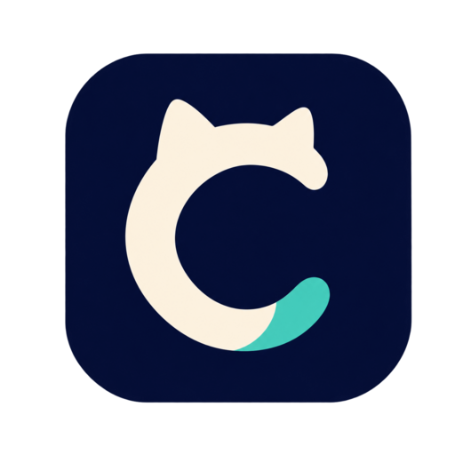
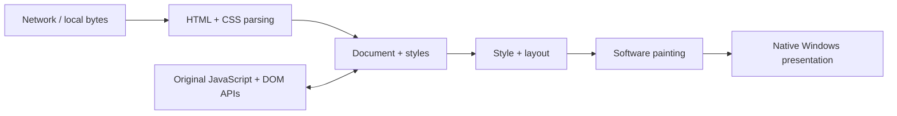

<div align="center">



# ChezCat Browser

### An original browser engine. Written in Rust. Built one shared capability at a time.

*From network bytes to page pixels—networking, JavaScript, DOM, layout,
rendering, and selected media decoding.*

[](https://github.com/c-a-t-f-o-o-d/chezcat-browser/releases/tag/v0.82.0-alpha.2)
[](docs/BUILDING.md)
[](docs/ARCHITECTURE.md)
[](https://github.com/c-a-t-f-o-o-d/chezcat-browser/actions/workflows/offline.yml)
[](LICENSE)

**[📦 Download](https://github.com/c-a-t-f-o-o-d/chezcat-browser/releases/tag/v0.82.0-alpha.2)** · **[🗺️ Roadmap](docs/ROADMAP.md)** · **[🔨 Build](#build)** · **[🧪 Compatibility](docs/COMPATIBILITY.md)** · **[📖 Documentation](#documentation)**

</div>

---

> [!WARNING]
> **Experimental browser—not yet a daily driver.** Modern websites can render
> incorrectly or fail to interact. Content runs in the browser process with worker
> threads, without an OS renderer sandbox. Passing CI is not a security
> certification or a claim of complete website support.

## Why ChezCat?

ChezCat is a Windows x64 browser built around its **own engine**, rather than an
embedded Chromium, Gecko, WebKit, or external JavaScript/codec runtime.

| 🦀 Original implementation | 🌐 Shared web capabilities | 🔬 Observable progress |
| :--- | :--- | :--- |
| Original Rust with **zero third-party production Cargo dependencies**. | Standards-aligned language, DOM, CSS, and resource behavior—not website-specific replacements. | Real page output, input, and asynchronous behavior, with exact limits and remaining failures recorded. |

Rust's standard library, Windows APIs, reviewed data, assets, and development
tools still have their own roles and licensing obligations. See
[third-party notices](THIRD_PARTY_NOTICES.md).

## What is here

| Area | Current foundation |
| :--- | :--- |
| 🖥️ **Native browser shell** | Tabs, multiple windows, link context actions, address search, bookmarks, settings, optional history, downloads, and About/build identity. |
| 🧩 **Web platform** | Original HTML/DOM, a bounded JavaScript interpreter, events, CSS layout, and software painting. Compatibility is growing through shared fixes. |
| 🔐 **Networking and trust** | Original HTTP(S), TLS/certificate handling, memory-only session cookies, redirects, and explicit resource/CSP boundaries. |
| 🎞️ **Selected media** | Original constrained VP8, PCM audio, and Matroska paths with finite playback interfaces—not general streaming or working YouTube playback. |
| 🧪 **Compatibility workloads** | Original regressions plus separate, unmodified legacy and modern framework fixtures. Loading, startup, rendering, input, and async results remain distinct. |

These are **implemented slices, not complete standards support**. The
[capability matrix](docs/CAPABILITIES.md) owns the detailed limits; the
[compatibility report](docs/COMPATIBILITY.md) records measured application outcomes.

---

## Choose your build

| You want… | Start here | What you are getting |
| :--- | :--- | :--- |
| **A fixed downloadable snapshot** | [📦 0.82.0-alpha.2](https://github.com/c-a-t-f-o-o-d/chezcat-browser/releases/tag/v0.82.0-alpha.2) | A published prerelease with runtime/source ZIPs, notices, checksums, and its own source identity. |
| **Newer integrated development** | Public `main` + [build instructions](#build) | Source changes that may not exist in the published executable. Check the current CI result. |
| **Work under review** | [🔎 Open pull requests](https://github.com/c-a-t-f-o-o-d/chezcat-browser/pulls) | Feature-branch work with its own results and remaining checks; not necessarily in `main`. |

> [!IMPORTANT]
> **New source does not update an old download.** Published release assets remain
> unchanged. Named releases are created only on explicit owner request; ordinary
> commits, PRs, CI runs, and development builds do not require a release.

**`0.82.0-alpha.2` is available for download.** All four published files match
their recorded digests for tagged source `f2e1823266a7c08c89bce7293572d801da62053c`.
[Download and runtime checks](docs/RELEASING.md#published-baseline)

**Release candidate `0.82.0-alpha.2`** consolidates the integrated changes through
`1de1f24`. Its [source notes](CHANGELOG.md#0820-alpha2) describe the new scope;
Windows release validation and verified publication are still pending. The
published download above remains the verified baseline until delivery completes.

Commit-identified development downloads and a possible `dev` channel remain
roadmap items, not advertised delivery options. The CI badge reports source
privacy and configuration checks on the latest trusted push to main.

## Development highlights

*Snapshot: November 21, 2026 · integrated source `1de1f24`; release candidate
`0.82.0-alpha.2`.*

| State | Improvement | Evidence and boundary |
| :--- | :--- | :--- |
| ✅ **Merged** | **Async, generators and language primitives** | Expanded supported `await`/`yield` paths, async iteration, BigInt width conversion and UTF-16/RegExp behavior retain explicit syntax and work boundaries. |
| ✅ **Merged** | **Templates and genuine DOM mutations** | Inert HTML/template clone, import, stamping and observers preserve node identities, edited controls and resource authority. [Selected component path](https://github.com/c-a-t-f-o-o-d/chezcat-browser/pull/416) |
| ✅ **Merged** | **Native interfaces and author properties** | Range, event families, canonical descriptors and supported author prototypes extend real DOM behavior. Full native Custom Elements and Shadow DOM remain incomplete. |
| ✅ **Merged** | **Native base URLs and relative resources** | [PR #429](https://github.com/c-a-t-f-o-o-d/chezcat-browser/pull/429): `Node.baseURI` follows admitted owner/document bases; an App fixture checks relative images, edited input and links. |
| ✅ **Merged** | **Asynchronous requests and response bodies** | Finite main-document text XHR and original Headers/Response primitives; global Fetch, preflight, streaming and wider response cases remain gaps. |
| ✅ **Merged** | **Shared CSS and SVG presentation** | Sizing math, viewport units, inline-flex, focus/hover, visibility/stacking and supported SVG CSS geometry/cascade/paint use shared layout and input paths. |
| ✅ **Merged** | **Capacity and storage corrections** | Iterative flattening and checked compiler/runtime/DOM/resource storage remove selected independent count ceilings. Image, font, HTTP and media paths retain real format/output/work guards. |
| ✅ **Merged** | **Faster development builds and test pages** | `build_dev.cmd` reuses incremental development artifacts; the home page adds test websites and original scenarios. Normal release optimization is preserved. |

Earlier recorded **jQuery 4.0.0** app checks pass startup, trusted input and a timer update.
Separate **Vue 2.7.16** and **Vue 3.5.45** apps pass mount, input and asynchronous
updates. The pinned Bootstrap 5.3.9 dropdown passes trusted open, choice and close
at 640 and 1280 px. Legacy jQuery stops during attribute detection, and ReactDOM
stops before the component mounts. The scorecard identifies the build and last
successful interaction for each app. [Compatibility records](docs/COMPATIBILITY.md)

The latest recorded signed-out YouTube check on `cad5f7c` still shows a skeleton
and reaches a script deadline during DOM traversal. PR #430 improves one original
traversal fixture; a usable YouTube homepage or playback has not been demonstrated.

### Next: useful pages, then measured speed and stronger isolation

| Now | Next foundations | Later, when ready |
| :--- | :--- | :--- |
| Shared DOM/events, JavaScript semantics, CSS variables/colors, and image/font/layout correctness. | Broader representative framework interactions and lightweight performance baselines. | Sandboxed content processes and measured GPU rendering with a software fallback. |

**[Explore the full roadmap →](docs/ROADMAP.md)** for milestone IDs, dependencies,
completion evidence, and deferred work. Isolation and GPU acceleration are planned,
not implemented; they do not block the current compatibility work.

---

## Inside the engine



*A conceptual view, not a complete scheduling or security diagram.* Browser-owned
services and document-owned work keep explicit lifetime, origin, and access
boundaries. The implementation currently uses **one Windows process with worker
threads**. See [architecture and boundaries](docs/ARCHITECTURE.md).

## Scope

<details>
<summary><strong>🖥️ Browser, navigation, and resources</strong></summary>

Native tabs/windows and guarded current, foreground/background-tab, and new-window
link actions are implemented. Address search supports Google by default, Bing,
DuckDuckGo, or None; explicit URL/file intent remains distinct. Settings,
bookmarks, optional history, downloads, and diagnostics are available within their
contracts. Named contexts, script-opened windows, and wider accessibility remain gaps.

Trust data contains a pinned, conservative **98-authority Mozilla NSS subset**
with provenance and explicit custom-store replacement. It is public data, not an
external TLS engine or a guarantee that every HTTPS site will connect. See
[HTTPS trust](trust/README.md) and [security](SECURITY.md).

</details>

<details>
<summary><strong>🧩 JavaScript, DOM, events, and rendering</strong></summary>

Finite shared primitives include live Document/Node child lists, genuine roots,
ordinary tree cloning and outerHTML. Supported hidden/text-input operations,
created checkboxes/radios and checkbox/TEXTAREA fragments preserve native form
state. TEXTAREA and radio clones retain independent live/default state. Unsupported
control, resource and ownership cases still reject without partial publication.

Finite base/derived classes, supported async/await and generator forms, BigInt,
weak collections and ordinary-object Proxy/Reflect operations are implemented.
Their syntax, traps and host coverage remain bounded. Inert templates, supported
clone/import/mutations, observers, Range and author properties use real native
identities. Full native Custom Elements/Shadow DOM, arbitrary input-type
transitions, modules and broader host APIs remain gaps. Supported mouse, keyboard,
focus, wheel, animation and error events preserve branded state. Listener objects
resolve `handleEvent` at delivery; wider event/pointer behavior remains limited.

The software renderer supports calculated spacing, custom properties, rounded boxes
and implicit single-column grids. Support for Google Search, Images, and Maps
remains partial. See the
[capability matrix](docs/CAPABILITIES.md) and [compatibility results](docs/COMPATIBILITY.md).

</details>

<details>
<summary><strong>🎞️ Media and current playback limits</strong></summary>

Selected local IVF/VP8, PCM audio, and constrained Matroska A/V use original
decoders. Finite version-zero single-vector interframes, source replacement,
seeking, native controls, and selected script playback operations are supported
under their contracts. Supported network media uses bounded complete responses
with explicit source and credential policies.

Wider interframe modes, hidden frames, streaming, multiple players, dynamic
crossOrigin controls, and full HTMLMediaElement behavior remain outside the
implemented scope. **Ordinary YouTube playback is unsupported.** Controlled
output checks do not establish physical audibility or general device compatibility.

</details>

---

## Build

### 1 · Prepare Windows x64

Use Microsoft C++ build tools/Windows SDK, **Rust 1.99.1 MSVC**, and **Python 3.14.8**
for verification scripts. From your source checkout:

```powershell
rustup toolchain install 1.99.1 --profile minimal --component clippy --no-self-update
python tools/accept_license.py --show
```

### 2 · Read the terms, then build

The following records an affirmative **personal-scope** acceptance. Run it only
after reading and deciding to accept the exact terms:

```powershell
python tools/accept_license.py --accept-license 34003a38eeb1db77472c307e23b5a5540c7625c50d9f0ea0dc7bacf6e5b9b749 --license-scope personal
.\Build.cmd
```

Use `--license-scope organization` only with the required organizational authority.
Missing or changed-text acceptance blocks builds and ordinary execution; help and
license viewing remain available.

### 3 · Run with the matching resources

`Build.cmd` writes **`ChezCat.exe`** beside the project. Keep its accompanying
pages, assets, trust data, and notices together. Rust and Python are development
tools, not application runtime dependencies.

<details>
<summary><strong>🧪 Verification and development checks</strong></summary>

For ordinary PRs, compile where relevant and run the small reproduction or tests
that exercise the change. Include a targeted negative check for a changed security
or resource boundary. The complete offline verifier runs for an owner-requested release.

```powershell
python tools/verify_offline.py
```

Routine hosted checks inspect snapshot privacy, package configuration and public
summary handling. The development agent investigates failures and fixes the
affected work. Physical desktop, audio-device, and public-site
observations are separate evidence. See [building and testing](docs/BUILDING.md)
and the [release procedure](docs/RELEASING.md).

</details>

## Documentation

| Explore | What you will find |
| :--- | :--- |
| 🗺️ [**Roadmap**](docs/ROADMAP.md) | Merged work, current milestones, dependencies, and future architecture. |
| 📋 [**Capabilities**](docs/CAPABILITIES.md) | Implemented behavior, explicit limits, and unsupported areas. |
| 🧪 [**Compatibility**](docs/COMPATIBILITY.md) | Versioned framework/workflow observations and first remaining blockers. |
| 🏗️ [**Architecture**](docs/ARCHITECTURE.md) | Component ownership, execution, rendering, and security boundaries. |
| 📐 [**Feature contracts**](docs/FEATURE_CONTRACTS.md) | Lasting behavior and acceptance requirements. |
| 🔧 [**Build guide**](docs/BUILDING.md) | Toolchain, source builds, and verification. |
| 📦 [**Release procedure**](docs/RELEASING.md) | Delivery for explicitly requested releases. |
| 📝 [**Changelog**](CHANGELOG.md) | Recorded source history. |

## Development and reporting

Development uses one open product PR at a time. Merge each coherent change after
its focused checks, then start the next change from updated main.

For bug reports and contributions, read [CONTRIBUTING.md](CONTRIBUTING.md). For
security concerns, follow [SECURITY.md](SECURITY.md).

<details>
<summary><strong>🔎 Connection-only diagnostics</strong></summary>

Use `--diagnose URL --report FILE`; optional `--diagnose-allow-host HOST` entries
restrict destinations before DNS. These reports run no page scripts or
subresources and do not establish page usability. See the
[T1 contract](docs/FEATURE_CONTRACTS.md).

</details>

---

## Licensing

ChezCat is **source-available under [CSAPUL 1.1](LICENSE)** for the releases
designated in [LICENSE_SCOPE.md](LICENSE_SCOPE.md). Personal and ordinary internal
workplace use, source review, and permitted private modifications are allowed
under its terms. General redistribution, hosted access, and independent commercial
offerings remain restricted; the exact license controls.

**This is not an OSI-approved open-source license.** Independent third-party terms
and valid grants for earlier releases remain unchanged.

<details>
<summary><strong>License identity and related policies</strong></summary>

License SHA-256: `34003a38eeb1db77472c307e23b5a5540c7625c50d9f0ea0dc7bacf6e5b9b749`.

[License acceptance](docs/LICENSE_ACCEPTANCE.md) · [Third-party notices](THIRD_PARTY_NOTICES.md) · [Branding](docs/BRANDING.md) · [Changes from 1.0](licensing/CHANGES-1.1.md)

</details>

<div align="center">

**An original engine. Measured progress.**

[Roadmap](docs/ROADMAP.md) · [Build guide](docs/BUILDING.md) · [Compatibility](docs/COMPATIBILITY.md)

</div>
