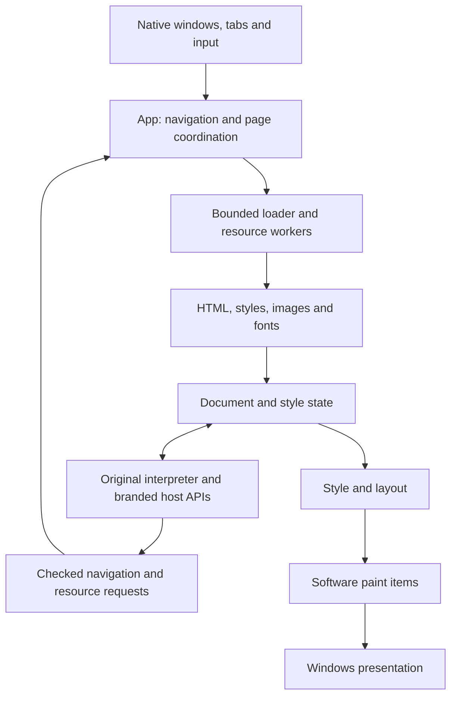

# Architecture and boundaries

*Original Rust. Explicit ownership. One shared path from bytes to pixels.*

[Home](../README.md) · [Roadmap](ROADMAP.md) · [Capabilities](CAPABILITIES.md) · [Compatibility](COMPATIBILITY.md)

---

## At a glance

| Area | Current design | Not implemented by this design |
| :--- | :--- | :--- |
| **Engine** | Original Rust networking, JavaScript, DOM, style/layout, software rendering, and selected media decoding | An embedded Chromium/Gecko/WebKit engine or external JavaScript/codec runtime |
| **Process model** | One Windows process with worker threads | A separate renderer process or OS renderer sandbox |
| **Ownership** | Browser-owned services, document-owned work, checked tab/window identities | Unrestricted page access to profiles or other tabs |
| **Graphics** | Software paint items presented through Windows APIs | A GPU rendering backend |
| **Execution** | Bounded interpreter jobs and cooperative cancellation | Complete ECMAScript, whole-process memory isolation, or guaranteed cancellation of blocking OS calls |

> [!WARNING]
> **Memory-safe language choices are not a browser sandbox.** FFI, cryptography,
> resource policies, aggregate memory, and availability still require review and
> negative testing. Isolation and GPU work are roadmap items, not current features.

## From bytes to pixels

This is a component map, not a complete event-order diagram. App commits navigation
and history state; workers fetch or read bounded inputs; parsing builds document
and style state. Windows APIs provide native window/input/presentation and
low-level audio output.

## Browser services and page ownership

Profile, downloads, and saved-history authorities are separate from page state.
App views retain owned snapshots and weak access handles: a view cannot extend an
authority's lifetime or perform final history shutdown. Saved-history settings
carry an original policy token and check the latest policy inside the existing
locked file transaction. Row selections retain the complete observed entry, so a
refreshed same-ID replacement cannot become the selected action.

The browser coordinator performs final history shutdown. Dropping an App does
not silently clear history or perform disk I/O.

### Sessions, tabs, and native windows

The Session core owns bounded collections of boxed Apps and adopts the initial
App's existing service authorities. Full tab/window identities combine a checked
process-wide Session generation and a nonreused local serial. Scoped callbacks
and typed wake messages avoid retaining App pointers in workers.

Closing an owner removes its routes before consuming its Box, retires source
tokens, and drops its realm/resource workers. The native shell binds checked
Session identities to real windows, tab chrome, shortcuts, and tab-pinned
inspectors. Native registry keys contain no App addresses; routing resolves the
current owner again after reentrant native operations. Guarded link intents admit
current, foreground/background-tab, and new-window actions. Named contexts,
script-opened windows, and wider accessibility remain outside this finite shell.

## Language and DOM boundaries

The interpreter is an original bounded implementation with realms, objects,
closures, promises/jobs, and browser host routing. Native handles require genuine
owner/receiver provenance. Main and supported child contexts have distinct
intrinsic roots; child DOM support is a deliberately limited read-only subset.
Node/Element ancestry does not fabricate every specialized immediate prototype.

The scripting Page owns one document realm. File/network work is handed to App
through bounded requests rather than performed by page callbacks on arbitrary
background threads. Main-document asynchronous text XMLHttpRequest uses that
native request/completion path with cancellation, origin/CSP and credential checks.
It buffers responses; general Fetch, streams, preflight and wider response types
remain incomplete. Headers and buffered Response values are separate implemented
primitives and do not by themselves provide network Fetch.

Supported inert documents and template contents retain distinct owners and stable
native identities. Checked clone/import, mutation observation and selected
same-identity promotion connect them to the displayed document. Newly created
inert Text nodes reserve their eventual native identities when backing is
available. Under native quota exhaustion they retain inert staging and refuse
direct promotion atomically; import copying remains supported. General inert
subtree cloning and broader owner transitions retain separate limitations.
Supported inert HTML/custom/style and SVG constructors also reserve native
identities; promotion rechecks current attributes and resource policy. These shared DOM paths can support authored Web Components
polyfills without advertising a native custom-element registry or complete Shadow
DOM. The current approach extends these paths; it does not require an architecture
rewrite before the selected component journey can progress.

UTF-16 language/host operations, modules and other APIs retain the specific
boundaries in [implemented capabilities](CAPABILITIES.md). Application results
belong in the [measured compatibility record](COMPATIBILITY.md).

## Resource and rendering boundaries

Networking uses original HTTP/TLS/certificate/cookie/URL code. Resource type,
origin, CSP, credentials, and local-root policies remain explicit. Unsupported
protocol or policy behavior is refused or documented; TLS revocation/CT and broad
browser conformance are not claimed. Cookie/public-suffix data has a separate
provenance and refresh lifecycle.

A supported CSS background URL retains its winning declaration's stylesheet owner
and final redirected base. Backgrounds reuse the image worker and resource
policies with separate binding slots and bitmap maps, keeping replaced-image
state and natural dimensions independent. Block decorations share layout, clip,
paint, and input-occlusion rules. Initial and callback-selected background work
participates in the real document-load checkpoint.

## Media pipeline

<strong>🎞️ Decoding, clocks, and source retirement</strong>

Local media uses original container/codec/sample code and real decoded frames or
samples. Source-retirement tokens, checked generations, and worker cancellation
prevent stale work from publishing. Native presentation/audio APIs do not replace
decoding.

The authored path supports one connected parser video, finite IVF/VP8 or Matroska
VP8/PCM16, native controls, source replacement, and genuine JavaScript
load/play/pause/currentTime operations. Sources keep separate in-root local-file
authority or an immutable document-owned HTTP(S) transaction context. Network
media uses complete bounded GET responses and the existing decoder/player,
without ranges or a separate runtime. Missing crossorigin retains exact-origin
policy; explicit authored modes use dedicated CORS/credential checks, sticky
redirect state, and normal cookie protections. Dynamic crossOrigin APIs remain
unsupported.

Standalone PCM and Matroska A/V have separate contracts. The finite VP8 profile
supports visible version-zero single-vector interframes with immutable YUV
references and transactional entropy/filter/segment updates. Each requested frame
replays from its preceding keyframe under shared work and packet limits; failed
or canceled work cannot publish reference state or stale pixels. Matroska video
follows the acknowledged PCM sample clock. Authored audio remains finite PCM16;
streaming, MSE, multiple players, and complete HTMLMediaElement behavior are not
implemented.

## Bounds and known limits

Work, retained data, collection sizes, and decoder allocations have explicit
bounds, with adjustable policies where implemented. Cancellation is cooperative;
outer process watchdogs remain necessary. These controls are not a whole-process
memory sandbox. Parser, codec, FFI, and aggregate-memory coverage need continued
negative testing and review.

| Planned direction | Readiness and boundary |
| :--- | :--- |
| **Performance measurements** | Compare successful, repeatable workloads before selecting optimizations. |
| **Restricted content processes** | Separate privileged services from untrusted content with validated bounded communication; multiple processes alone are insufficient. |
| **GPU compositing/presentation** | Preserve original rendering behavior and a software fallback; handle device loss. |
| **Video acceleration** | Presenting decoded frames is distinct from replacing the decoder; the latter needs a separate policy decision. |

These are recorded in the [roadmap](ROADMAP.md#performance--architecture), not
implemented by this documentation. Keep improving the existing modular Rust
application rather than introducing a rewrite or speculative framework.
