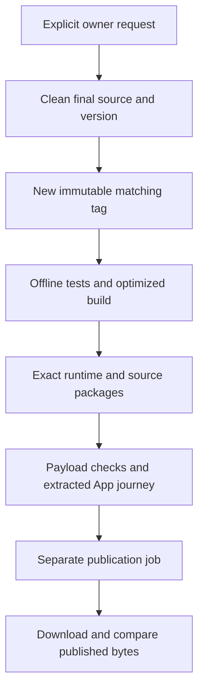

# Development and releases

*Frequent source progress. Explicit release decisions. Verified delivery.*

[Home](../README.md) · [Roadmap](ROADMAP.md) · [Capabilities](CAPABILITIES.md) · [Documentation](README.md)

---

## Release policy

> [!IMPORTANT]
> **Named releases require an explicit owner request.** Queue it after the current
> coherent implementation checkpoint. A merged PR, passing CI or completed feature
> does not authorize a version bump, release tag, package or publication.

| Activity | Normal path | Release required? |
| :--- | :--- | :--- |
| **Source development** | Short-lived `feat/`, `fix/`, `docs/`, or `security/` branch, coherent commits, PR and existing checks | No |
| **Integrated source** | Changes merged into `main` after focused development checks | No |
| **Development artifacts / dev channel** | Proposed roadmap work; not assumed operational | No |
| **Named release** | Owner request → final source → immutable tag → exact delivery gates | Yes: explicit authorization |

Keep one product PR open at a time. The agent investigates failed checks and
fixes the affected work. After a merge, start the next PR from updated main.

[Routine verification](#contribution-and-routine-verification) · [Tagged delivery](#exact-tagged-delivery)
· [Payloads](#payloads-and-identity) · [Failures](#when-a-check-fails)

## Development discipline

Use tested main and short-lived branches with PR integration and recorded checks.
Identify solo maintainer/agent review honestly; do not invent a second reviewer.
Keep one primary finite feature contract active. `release/` branches serve genuinely
maintained parallel lines only. Never import pre-transition private ancestry or
recovery refs into the public graph.

Ordinary commits retain the product version. Product and CSAPUL license versions
are independent. During 0.x, minor versions can change a stated interface; patch
versions preserve its contract except documented security necessities. Alpha/RC
contracts remain unstable. Persisted-data changes require migration/recovery
checks. See [feature contracts](FEATURE_CONTRACTS.md) and [capabilities](CAPABILITIES.md).

A completed PR is a checkpoint, not a requirement to stop development or issue a
release. Source integration, green CI, development-runtime delivery and publication
are different states. Report only the state actually reached.

## Current release candidate

The immutable `v0.82.0-alpha.2` tag identifies
`14134aba8ac2ab001c8ec13db77f68fa220b1400`, including merged source through PR #430
and the matching Cargo/resource versions and [change summary](../CHANGELOG.md#0820-alpha2)
prepared in PR #431. The
[tagged Windows workflow](https://github.com/c-a-t-f-o-o-d/chezcat-browser/actions/runs/44971512445)
failed at the normal native-test stage. The optimized build, package checks,
publication and downloaded-byte verification were not reached. **No alpha.2
release assets were published; alpha.1 remains the verified download.**

The failure-summary step also rejected its relative output path, so this run's
public output does not identify the failing native tests or their root cause.
Keep that diagnostic gap explicit. Current development source corrects the
summary invocation to use its checked absolute default output path, preserving
the existing privacy and containment rules. That repair applies to future runs;
it cannot recover this completed runner's missing diagnostics or identify the
native failure. Establish that cause before claiming qualification. Changed release source
requires the next unused version and tag; preserve this candidate's immutable tag.
Development source after the tag, including PR #433, is not part of this attempt.

## Published baseline

| Snapshot | Recorded outcome |
| :--- | :--- |
| **v0.82.0-alpha.2** | Immutable candidate at `14134aba8ac2ab001c8ec13db77f68fa220b1400`. Normal Windows test stage failed; failure-summary reporting also failed. Packaging was not reached and publication was skipped. No release assets. [Validation attempt](https://github.com/c-a-t-f-o-o-d/chezcat-browser/actions/runs/44971512445) |
| **[v0.82.0-alpha.1](https://github.com/c-a-t-f-o-o-d/chezcat-browser/releases/tag/v0.82.0-alpha.1)** | Published from `f2e1823266a7c08c89bce7293572d801da62053c`. All four downloads matched their public digests. Both archives and the release notes passed verification. The extracted browser started and completed the App input journey. [Tagged workflow](https://github.com/c-a-t-f-o-o-d/chezcat-browser/actions/runs/44400222193) |
| **[v0.81.0-alpha.3](https://github.com/c-a-t-f-o-o-d/chezcat-browser/releases/tag/v0.81.0-alpha.3)** | Published from `57cc1d5`; runtime/source ZIPs, `publication.json` and `SHA256SUMS` all downloaded and verified, including extracted runtime checks |
| **v0.81.0-alpha.2** | Published from `36adf20`, with runtime/source ZIPs, `publication.json`, `SHA256SUMS`, and downloaded/extracted verification |
| **v0.81.0-alpha.1** | Immutable validation candidate; runtime documentation-link failure stopped publication. Tag retained, no release assets published |
| **Earlier published releases** | Keep their original source, assets, licensing and valid grants unchanged |

Independent checks of the downloaded alpha.1 runtime also verified PE identity,
the actual on-wire HTTP User-Agent, CLI help, and displayed About information
with its captured Copy payload. Earlier release rows retain their original identities.

The [alpha.2 release](https://github.com/c-a-t-f-o-o-d/chezcat-browser/releases/tag/v0.81.0-alpha.2)
was a one-time catch-up for finite B2 and integrated prerequisites. Its completed
delivery does not authorize another release or retroactively include newer source.

## Contribution and routine verification

For a development PR, compile where relevant and run the affected reproduction or
focused tests, including a negative check for a changed security or resource
boundary. Reuse applicable results for unchanged code. An owner-requested release
runs `tools/verify_offline.py` for the normal Windows suite, optimized build,
PE/resources/version/import checks, identity/packaging controls and local App/input
journeys. Preserve normal failures and serial diagnostics separately.
Routine browser verification is offline. Public sites, physical desktop and audio
devices require separate scoped evidence.

Trusted maintainer branch and main pushes check committed snapshot paths and
private receipts, package version configuration and public summary privacy.
The separate external-evaluation workflow does not fetch or execute substantive
submissions: external intake remains reports-only until its permission/record
controls are operationally verified.

<strong>🔐 External intake, permissions, and license acceptance</strong>

Before substantive evaluation, verify exact-version C2 assent, private storage,
authority records, immutable submission identity and agreement digest. A dispatch
input or green run is not assent. Maintained inclusion separately requires an
executed assignment and countersigned Schedule A for the exact scope. Keep
signatures and identity records private under [contributor privacy](CONTRIBUTOR_PRIVACY.md).
Owner-controlled work needs no fictional outside signature; independent platform
and limited original bug-reproducer rights remain separate. See
[contributing](../CONTRIBUTING.md).

Build/test jobs use read-only permissions, pinned actions and hosted runners.
No secret-bearing privileged `pull_request_target` checkout or personal desktop
runner evaluates public submissions. External evaluation has no shared source
cache or downstream release promotion. CodeQL eligibility for CSAPUL is not assumed.

Before executing the browser, the maintainer release job runs
`python tools/accept_license.py --accept-license <approved-full-license-sha256>
--license-scope personal`, with `CHEZCAT_LICENSE_RECEIPT_DIR` pointing to an external
runner-temporary directory. This records only the owner's scoped authorization,
not outside contributor assent. Directory selection alone grants no acceptance.
Keep receipts out of logs, caches and artifacts. Extracted checks validate the
same exact terms; changed license text needs fresh affirmative acceptance.

## Exact tagged delivery

The diagram summarizes existing responsibilities; it is not a new automatic
promotion mechanism. A failed gate leaves the requested delivery incomplete.

| Step | Required action | Do not substitute |
| :--- | :--- | :--- |
| **1 · Prepare** | Finish the finite scope, review trust-boundary changes, and deliberately update version/resources and release notes | Automatic versioning after every feature |
| **2 · Bind source** | Validate the exact clean final commit, including merge identity; refresh main without force updates | Old build evidence relabeled as new source |
| **3 · Tag** | Create an unused immutable `v<fullCargoVersion>` tag on that source | Moving/reusing a tag after source changes |
| **4 · Build and package** | Existing `release.yml` checks the exact tag/license, runs offline gates, packages source/runtime/checksums and exercises extracted output | A locally staged ZIP treated as published |
| **5 · Publish** | Separate write-permission job checks transferred hashes and remote tag, creates the release, uploads explicit assets, downloads and compares their bytes | A source merge or successful upload attempt treated as verified delivery |

The operative CSAPUL 1.1 LICENSE digest remains
`34003a38eeb1db77472c307e23b5a5540c7625c50d9f0ea0dc7bacf6e5b9b749`.
Existing releases retain their exact supplied license and earlier valid grants.
Never rewrite their tags/assets to adopt later terms.

The tag/manual workflow has no daily schedule. One publication concurrency group
serializes manual/tag runs without canceling an in-progress release. Trusted branch
push CI is verification—not automatic release promotion. The publication job has
`contents: write` and executes no project code; ordinary jobs/defaults remain
read-only. Pinned actions and exact inputs retain their existing requirements.

## Payloads and identity

| Payload | Required contents | Excluded |
| :--- | :--- | :--- |
| **Runtime ZIP** | Executable, matching pages/assets/trust, notices/data, LICENSE and containing-revision scope, acceptance/privacy/contribution policies, change summary, product docs, exact build identity | Receipts, profiles, private operations, unrelated workspace contents |
| **Source ZIP** | Buildable tracked source/resources/fixtures with applicable notices and source identity | Application binaries and private operations |
| **Public provenance** | Actual source/tag, compiler/payload identities, performed checks and checksums | Private logs; invented signing, certification or reproducibility claims |

Verify working/blob/ZIP LICENSE digests, tag/source agreement, complete payload and
an extracted offline journey. Scope contains exactly one
`Scope: containing-source-revision` and one matching `License-SHA256: <digest>`
line. Parentless snapshots are valid; old ancestry lists and withdrawn identities
are not release prerequisites. Do not recursively archive a development workspace.
Missing/draft/mismatched licensing or dirty/stale proof fails closed. The packager
does not publish; the workflow performs actual delivery.

Cargo, UI/help/User-Agent and Windows string metadata use the full release SemVer.
Windows numeric fields map MAJOR,MINOR,PATCH,0, each within 16 bits, with prerelease
labels in strings/tag. Historical version text is not rewritten. Source SHA,
clean state, compiler/target and payload hashes identify bytes; they do not certify
security or cross-SDK/linker bit-for-bit reproducibility.

## When a check fails

Record the failed stage and its concrete evidence. The agent investigates and
repairs the affected work without hiding failure, reducing assertions or treating
a diagnostic serial pass as the required normal result.

Release blockers include failed exact-source checks, missing required acceptance,
an unresolved exposed high/critical runtime defect, unavailable publication access,
or package/download failure. Keep the checkpoint and continue safe independent
work; repeated release retries must not consume the browser-development queue.
A no-source-change service rerun is recorded. Changed source needs a new unused
release version/tag, not replacement bytes under an old identity.

Reuse recorded licensing/publication decisions unless material facts change.
Absent exhaustive certification is not a substitute for concrete risk disposition.
Release notes state supported/deferred behavior, exact source/tag, assets and
SHA256SUMS. `publication.json` is descriptive evidence, not a signed attestation.
Later license changes need an explicit revision and scope/release record.
