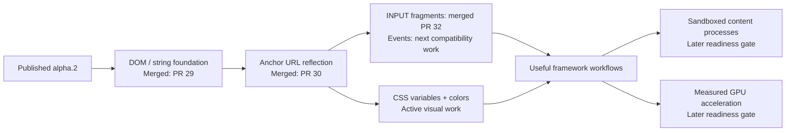

# 🐱 ChezCat Browser — Development Roadmap

*Delivering repeatable web page improvements through shared, spec-aligned browser capabilities.*

[Release horizon](#release-horizon) · [Active work](#active--upcoming-milestones) · [Architecture](#performance--architecture) · [Development protocol](#agent-execution-protocol) · [Backlog](#reference--backlog)

---

## Release Horizon

**Public source moves frequently. Named releases move only on owner request.**
Milestone IDs below describe work, not reserved versions, deadlines, or promises
of complete framework support. No date or version is assigned to the next release.

| Channel | What it contains | When it changes |
| :--- | :--- | :--- |
| **Published prerelease** | [0.81.0-alpha.2](https://github.com/c-a-t-f-o-o-d/chezcat-browser/releases/tag/v0.81.0-alpha.2), source `36adf20`, released November 17, 2026 (UTC) | Explicit owner request; immutable tag and assets |
| **Public `main`** | Integrated development source; PRs [#29](https://github.com/c-a-t-f-o-o-d/chezcat-browser/pull/29), [#30](https://github.com/c-a-t-f-o-o-d/chezcat-browser/pull/30), and [#32](https://github.com/c-a-t-f-o-o-d/chezcat-browser/pull/32) add behavior beyond alpha.2 | Coherent PRs after applicable integration checks |
| **Public feature branches** | Reviewable work in progress with its own check status | Meaningful implementation checkpoints, independently of releases |
| **Development binaries** | Planned CI artifacts identified by source commit, not another GitHub Release | Delivery work `DX-02`; not advertised as available yet |

This is a dependency and progress map, **not a calendar**. CSS and language/DOM
work proceed alongside one another. The diagram does not require isolation to
wait for complete framework or video support.

> [!IMPORTANT]
> **Owner-gated releases.** Completing a feature, merging a PR, or passing CI does
> not trigger a release. An explicit request is queued after the current coherent
> development task. Keep the existing verification workflow: the agent investigates
> failed checks and fixes affected work. A failed gate blocks promotion or
> publication; unrelated authorized coding can continue.

---

## Active & Upcoming Milestones

**Legend:** ✅ **Merged** · 🟡 **Under review** · ◻️ **Next / planned** · 🧊 **Deferred**

Snapshot: November 17, 2026, using public `main` at `e97dc85` and the linked PRs.
PR pages carry changing review and CI status. Branch-only results are not results
for `main` or for the published alpha.2 binary.

### DOM — Shared page behavior

**Goal:** Make standard DOM and language operations work across real library
workloads, without framework-specific substitutes.

| State | ID | Deliverable & scope | Completion evidence |
| :--- | :--- | :--- | :--- |
| ✅&nbsp;Merged | <code>DOM&#8209;01</code> | **String concat, hidden-input state, and genuine Node roots** | [PR #29](https://github.com/c-a-t-f-o-o-d/chezcat-browser/pull/29) integrated the finite contracts. This is not whole-framework compatibility. |
| ✅&nbsp;Merged | <code>DOM&#8209;02</code> | **Anchor HTTP(S) URL reflection** | [PR #30](https://github.com/c-a-t-f-o-o-d/chezcat-browser/pull/30) integrated scoped live URL values. Wider URL semantics remain bounded by the contract. |
| ✅&nbsp;Merged | <code>DOM&#8209;03</code> | **Native text INPUT fragments and retained editor state** | [PR #32](https://github.com/c-a-t-f-o-o-d/chezcat-browser/pull/32) integrated real editing/reset, dirty/default values, neighboring controls, ownership, atomic refusals, and focus retirement. Its pinned modern jQuery fixture passes startup; full interaction remains blocked. |
| ◻️&nbsp;Next | <code>DOM&#8209;04</code> | **Native Event own-property behavior** | Reproduce the trusted-input failure reported by PR #32; implement normal property lookup without weakening branded access. Recheck the unchanged modern jQuery input/timer workflow. |
| ◻️&nbsp;Next | <code>DOM&#8209;05</code> | **DocumentFragment and subsequent legacy DOM boundaries** | Reduce the next failure reported by PR #32, then verify fragment insertion, tree identity, form state, and rollback. Preserve the unchanged legacy workload and any next blocker. |

### CSS — Visible layout and color correctness

**Goal:** Improve the actual pixels and hit targets of representative pages, not
only their initial HTML paint or absence of script errors.

| State | ID | Deliverable & scope | Completion evidence |
| :--- | :--- | :--- | :--- |
| 🟡&nbsp;Under&nbsp;review | <code>CSS&#8209;01</code> | **Inherited custom properties in padding and borders** | [PR #31](https://github.com/c-a-t-f-o-o-d/chezcat-browser/pull/31) reports a real App reduction changing from 80×30 to 104×46, matching an opaque literal control's pixels, hits, and reflow. Hosted verification still gates integration; no full Bootstrap styling claim. |
| ◻️&nbsp;Investigate | <code>CSS&#8209;02</code> | **Alpha colors, including `rgba()`** | Establish the current parser/compositing boundary with an original reduction. Verify computed values, alpha composition, clipping, and painted output against a reference; do not assume every spelling is absent or supported. |
| ◻️&nbsp;Ongoing | <code>CSS&#8209;03</code> | **Image, font, sizing, and input-layout defects** | Rank reproducible visible failures by shared impact; keep real dimensions, resource outcomes, paint, and hit testing consistent. Select the next finite scope from evidence. |

### JS & Frameworks — From startup to useful interaction

**Goal:** Progress from loading a library to exercising an unchanged application.
A passing startup probe is a step, not a working application.

| State | ID | Deliverable & scope | Completion evidence |
| :--- | :--- | :--- | :--- |
| ◻️&nbsp;Planned | <code>JS&#8209;01</code> | **Object-prototype access used by the Vue workload** | Reduce the recorded Vue 2.7.16 boundary and implement shared semantics with receiver, realm, ordering, and access checks. Recheck mount, input, and asynchronous updates separately. |
| ◻️&nbsp;Planned | <code>JS&#8209;02</code> | **Class syntax and semantics used by modern applications** | Define a coherent parser/runtime slice from the recorded Bootstrap 5.3.9 failure. Test behavior, not merely parsing; preserve explicit limits for unfinished class features. |
| ◻️&nbsp;Dependency&#8209;gated | <code>FW&#8209;01</code> | **One modern Vue or React application** | Pin an official distribution and compatible dependencies. First record a genuine baseline; completion requires mounting, a user-driven state change, visible DOM/pixel output, and relevant asynchronous behavior. |
| ◻️&nbsp;Continuing | <code>FW&#8209;02</code> | **Modern and legacy cohort coverage** | Keep existing legacy samples and separate modern jQuery/Bootstrap cases. Add materially different generations when evidence makes them useful; never infer support for every version from one sample. |

Exact versions, build identities, stage results, and first failures belong in
[COMPATIBILITY.md](COMPATIBILITY.md) and [compatibility.json](compatibility.json).
Raw source line numbers remain in those evidence records, not in permanent
milestone names. Security defects and demonstrated shared dependencies can change
implementation order.

---

## Performance & Architecture

Keep the original Rust implementation and improve it incrementally. Do not start
a language rewrite, generic framework, or speculative parallel engine.

| State | ID | Milestone | Entry condition & finite outcome |
| :--- | :--- | :--- | :--- |
| ◻️&nbsp;Incremental | <code>PERF&#8209;01</code> | **Representative performance baselines** | Reuse successful original fixtures. Record parse/script/style/layout/paint time, input responsiveness, and retained memory across repeated navigation, with exact build/configuration and repeatable conditions. Failed or incomplete execution is not a speed win. |
| 🧊&nbsp;Later | <code>ISO&#8209;01</code> | **Sandboxed content processes** | Begin after representative load/render/input/navigation and selected media paths are repeatable, before positioning the browser for sensitive everyday use. Separate privileged browser services from restricted content; validate bounded messages, access refusals, crash containment, recovery, and resource limits. Multiple processes alone are not a sandbox. |
| 🧊&nbsp;Later | <code>GPU&#8209;01</code> | **GPU compositing/presentation with software fallback** | Start from measured rendering costs. Keep original rendering commands, add a bounded platform backend, verify equivalent behavior, device-loss recovery, and a “Use hardware acceleration when available” setting with active/fallback diagnostics. Expand rasterization only with evidence. |
| 🧊&nbsp;Separate&nbsp;decision | <code>GPU&#8209;02</code> | **Accelerated video presentation / decoding boundary** | Presenting our decoded frames is distinct from delegating decoding. No OS-codec fallback or replacement decoder is authorized by the graphics milestone; hardware decoding needs an explicit originality/dependency decision. |

Current reality remains [one browser process with worker threads and software
rendering](ARCHITECTURE.md). Isolation and GPU acceleration are **planned, not
implemented**. They are not prerequisites for the active compatibility fixes.
Neither depends on supporting every website first.

---

## Delivery — Frequent Source, Verified Builds

**Keep the current CI approach.** The development agent reviews failures and fixes
the affected work through the existing local, PR, and hosted checks. The proposed
asynchronous handoff is deferred; no workflow, branch-protection, or promotion
change is enabled by this documentation. Development source continues to advance
independently of owner-requested releases.

| State | ID | Deliverable | Exit criteria |
| :--- | :--- | :--- | :--- |
| 🧊&nbsp;Deferred | <code>DX&#8209;01</code> | **Asynchronous CI/CD handoff** | Retain the current agent-owned failure diagnosis and repair. Revisit handoff only by a later owner decision; do not transfer routine failed-build triage to the maintainer or weaken integration gates. |
| ◻️&nbsp;Planned | <code>DX&#8209;02</code> | **Commit-identified development artifacts** | Successful trusted CI exposes a complete, clearly labeled development payload with its real source identity, required notices/data, no private material, and bounded retention. It is not a release, tag, or version bump. |
| ◻️&nbsp;Proposed | <code>DX&#8209;03</code> | **Lightweight public `dev` integration channel** | Adopt only with explicit triggers, protected promotion, trusted identities, and no duplicate validation for unchanged inputs. Keep `main` current with promoted known-good work. Do not create another manually supervised release stage. |

For requested releases, preserve the selected source identity and use the existing
validation and publication procedure. The agent remains responsible for analyzing
and correcting failures. Continue safe independent work without modifying inputs
under verification; do not claim failed delivery succeeded. See
[RELEASING.md](RELEASING.md).

---

## Agent Execution Protocol

> [!NOTE]
> **One practical development cycle:** reproduce a concrete failure, implement
> the shared fix, run focused affected and security-negative checks, inspect the
> changed workflow, then commit and submit it through the applicable PR/CI gates.
> Full regression belongs at integration boundaries—not after every small edit.

Public feature branches should receive coherent, reviewable progress frequently.
A named release is not required for a commit, PR, CI run, or development build.
Keep changed source distinct from merged source, and merged source distinct from
published binaries. A completed PR is a checkpoint, not the end of the task queue.

Documentation has one owner per concern:

| Document | Responsibility |
| :--- | :--- |
| **This roadmap** | Order, milestones, dependencies, and backlog |
| [CAPABILITIES.md](CAPABILITIES.md) | Implemented behavior and limits |
| [COMPATIBILITY.md](COMPATIBILITY.md) + [catalogue](compatibility.json) | Versioned, measured application outcomes |
| [FEATURE_CONTRACTS.md](FEATURE_CONTRACTS.md) | Lasting behavior and acceptance requirements |
| [ARCHITECTURE.md](ARCHITECTURE.md) | Current system boundaries |
| [RELEASING.md](RELEASING.md) | Owner-requested delivery procedure |

Update only documents whose facts change in the same coherent implementation PR.
Do not turn routine synchronization into a fresh audit of every document. Keep
production original Rust/std-only, preserve security boundaries, and retain
unmodified upstream workloads with appropriate notices. Test counts alone do
not establish browser compatibility.

---

## Reference & Backlog

<strong>✅ Delivered foundations</strong> — published baseline and later source progress

| Delivery | Area | Finite scope |
| :--- | :--- | :--- |
| **alpha.2** | `B2` navigation | Native tabs/windows, guarded link gestures and context actions, independent page state |
| **alpha.2** | `A1` identity | About/build identity and offline license access; explicit acceptance remains its own contract |
| **alpha.2** | `CP1–CP5` prerequisites | Collection/Node, Comment/RegExp, responsive CSS, conventional select, and literal-prototype foundations |
| **alpha.2** | `T1 / B1` foundations | Scoped TLS/trust, dual-stack transport, stylesheet/resource and viewport behavior; broader coverage remains partial |
| **alpha.2** | Selected media/interfaces | Existing finite VP8/PCM/Matroska, Media/Video and event slices within their documented limits |
| **Post-alpha.2 source** | `DOM-01 / DOM-02 / DOM-03` | PR #29 string/hidden-input/Node-root work, PR #30 anchor URL reflection, and PR #32 native text INPUT fragments; not retroactively part of alpha.2 |

Published assets remain immutable. Read the [capability matrix](CAPABILITIES.md)
for exclusions and the [changelog](../CHANGELOG.md) for source history.

<strong>🧊 Deferred backlog</strong> — unscheduled, with no reserved release numbers

| Area | State & trigger |
| :--- | :--- |
| **Windows installation and updates** | Preserve one installer, About/license access, optional startup update check, “Check now,” and explicitly approved upgrade contracts. Portable ZIP remains the baseline; schedule after current browser foundations. |
| **Broader media and service playback** | Preserve working finite media slices. Streaming, wider codecs, ordinary YouTube playback, and broader media interfaces remain separate unproved work. |
| **Extended web platform** | Wider Unicode, ES modules, networking APIs, storage, workers, frames, accessibility, DOM interfaces, and font/layout coverage are selected by demonstrated shared dependencies. |
| **Additional element APIs** | VIDEO dimensions, Element.toggleAttribute, NamedNodeMap mutation, and other interfaces remain distinct contracts rather than implied framework support. |
| **Agent status automation** | Deferred; no new screenshot watcher, heartbeat service, or restart supervisor in the compatibility phase. |

*Dates document observations, not delivery promises. Named release versions are
chosen only for an owner-requested, eligible snapshot.*
