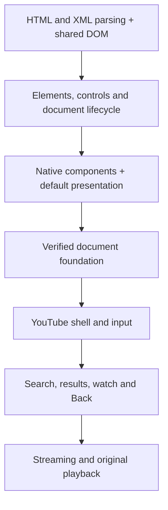

# 🐱 ChezCat Browser — Development Roadmap

*Delivering repeatable web page improvements through shared, spec-aligned browser capabilities.*

[Release horizon](#release-horizon) · [Active work](#active--upcoming-milestones) · [Foundation plan](HTML_FOUNDATION_PLAN.md) · [Architecture](#performance--architecture) · [Verification](#verification-and-documentation) · [Backlog](#reference--backlog)

---

## Release Horizon

**Each fully accepted milestone advances to named release preparation.**
Milestone IDs below describe work, not reserved versions, deadlines, or promises
of complete framework support.

| Channel | What it contains | When it changes |
| :--- | :--- | :--- |
| **Current prerelease** | [0.82.0-alpha.4](https://github.com/c-a-t-f-o-o-d/chezcat-browser/releases/tag/v0.82.0-alpha.4), tagged at `122d0b7`, delivers the accepted F00 baseline. Its Windows build, runtime/source ZIPs, publication record, checksums and extracted runtime passed verification. | [Verified release and asset hashes](RELEASING.md#current-verified-release) |
| **Public `main`** | F00 baseline and partial F01/F02/F04/F05 implementation, with continuing document, encoding, tokenizer and tree-construction work. | Source development continues through the [foundation register](HTML_FOUNDATION_COVERAGE.json). |
| **Public feature branches** | Reviewable work in progress with its own check status | Meaningful implementation checkpoints, independently of releases |
| **Development binaries** | Planned CI artifacts identified by source commit, not another GitHub Release | Delivery work `DX-02`; not advertised as available yet |

Earlier releases and validation candidates retain their exact source and outcomes
in the [release history](RELEASING.md#release-history).

This is a dependency map, **not a calendar**. The [foundation plan](HTML_FOUNDATION_PLAN.md)
defines the active package order, integration dependencies and closure evidence.
Full CSS, ECMAScript, media and the wider HTML application platform remain
explicit related programs; required dependencies cannot be counted as passes.
Isolation and GPU work keep their separate readiness gates.

> [!IMPORTANT]
> **Milestone delivery.** A milestone reaches acceptance after its required
> contracts and integrations pass. Its named release must then pass the
> exact-source validation and publication procedure. Record any failed delivery
> gate against that candidate.

---

## Active & Upcoming Milestones

**Legend:** ✅ **Merged / verified scope** · 🟡 **Partial / active** · ◻️ **Next / planned** · 🧊 **Deferred**

Current foundation increment: live getElementsByName filters retain exact UTF-16
and match authoritative native HTML names. Focused checks cover conversion,
liveness, admitted storage and refusal/recovery, with native App interaction.
Canonical Document.prototype.getElementsByName supports ordinary prototype changes,
saved functions and receiver/origin preflight for the displayed backend.
Owner-bound inert HTML/XML/generic and supported child live traversal now uses
actual roots, exact HTML names and native list realms with storage/origin checks.
Ordinary HTML container name setters and Attr routes now retain raw UTF-16
values for exact live queries, cloning and observation. Control/slot/frame/resource
raw-name producers, raw-name imports and child mutations remain open;
frozen browser qualification stays separate.

**Active priority: complete the document foundation before returning to the
YouTube journey.** The [reviewed plan](HTML_FOUNDATION_PLAN.md) and
[coverage register](HTML_FOUNDATION_COVERAGE.json) replace P1-first scheduling.
F00 has passed its requirements and baseline gate. F01, F02, F04 and F05 have
source-bound partial implementations. Required DOM, parser, form, editing,
lifecycle, native-component and browser integration gates remain open.

The retained P1 package has integrated nested template content, live ParentNode views,
inert queries, passive HTML and supported native-control import, plain image
activation, inline style batches and main-document template import/clone.
Finite namespace-aware SVG, mutation observation, selected component focus,
author properties and Node base URI behavior are also integrated. Remaining
native families/resources, broader same-identity adoption and lifecycle behavior
retain the limits in [capabilities](CAPABILITIES.md).

The previously reviewed signed-out homepage check used
[`cad5f7c`](https://github.com/c-a-t-f-o-o-d/chezcat-browser/commit/cad5f7c14a8fe8ebe2637e4c5269e84eed9697da),
after PR #429. The page still showed the skeleton and the DOM walker reached its
30-second deadline. PR #430 subsequently integrated at `1de1f24`; no post-PR #430
live acceptance result is recorded. A usable header, guide and search field
remain unproved.

<strong>Earlier homepage checkpoints</strong> — historical observations

An earlier clean `fff35f8` run at November 21, 04:13 UTC completed all 43
script executions and 61 callbacks without escaped errors but still rendered the
skeleton and logged an opaque error object. No usable shell is demonstrated.
These implementation checks do not prove a usable shell. The
[source-bound checkpoints](COMPATIBILITY.md#latest-reviewed-signed-out-homepage-checkpoint)
retain prior isolated development and owner-supplied observations separately.

The November 20 owner checkpoint on clean development source `cffb9d1` decoded
the main application script and completed 42 of 43 script executions, then stopped
on missing `Range`; the page remained a skeleton. [PR #359](https://github.com/c-a-t-f-o-o-d/chezcat-browser/pull/359)
subsequently integrated a displayed-document Range subset. Its implementation
checks are separate from a new live-site result. The connected component,
DOM, layout and input queue below supersedes those historical missing APIs. The older dev137
surrogate/STYLE/CSS failures are historical observations. [Latest reviewed owner checkpoint](COMPATIBILITY.md#latest-reviewed-signed-out-homepage-checkpoint)

The selected page uses its supplied Web Components polyfill. Native custom
elements and complete Shadow DOM are broader capabilities, not established
prerequisites for this selected first-shell path. Keep genuine DOM semantics and
truthful feature detection. Search submission, results, watch navigation/Back
and video/audio playback each require their own observed outcome.

### Active foundation sequence

| Stage | Required outcome |
| :--- | :--- |
| **F00–F03 · Contract and shared data baseline** | Fixed requirement/test inputs, genuine document/namespace/mode model, Encoding/MIME and standard URLs |
| **F04–F05 · HTML parsing** | All tokenizer states and tree-construction modes, error recovery, entities, foreign content and templates |
| **F06–F08 · DOM, markup and XHTML** | Complete shared DOM/bindings, contextual fragments/serialization and XML1.0/Namespaces/XHTML |
| **F09–F11 · Native document behavior** | Element families, scripts/resources/navigation, all form states, focus/activation and editing |
| **F12–F13 · Components and presentation** | Genuine native Custom Elements/Shadow DOM, UA defaults, mode consumers and required rendering/text integration |
| **F14 · Closure** | Required fixed cohorts and Windows App journeys pass; remaining wider-platform work is explicit before product resumption |

This is the default start order. Core implementation and integration closure are
separate: a missing later dependency keeps its consumer open until that
prerequisite and its integration are implemented. Focused checks establish each
increment; full-site results require their own evidence.

### Current product sequence

**Planned after foundation acceptance.** These P1–P6 packages follow the
document-foundation program.

The packages below connect the existing foundations to observable page behavior.
They are **not percentages of a complete browser**, and an implemented API family
does not close its corresponding site checkpoint.

| State | Package | Integrated foundation | Remaining scope and completion criterion |
| :--- | :--- | :--- | :--- |
| ✅ / 🧊 | **P0 · Capacity stabilization** | Iterative flattening and selected compiler/runtime/DOM, compression, image, font, HTTP and media storage/count corrections are integrated. | The broad inventory remains deferred. Re-enter a related family for a demonstrated limit or correctness problem; [remaining policies](CAPABILITIES.md#remaining-capacity-correction) stay recorded rather than being declared unlimited. |
| 🧊 Retained | **P1 · Template preparation and stamping** | Nested inert templates, queries/attributes, supported clone/import/mutations, real observers, author properties, native focus and selected component fixtures. Passive HTML/custom-host content replacement, supported inert Text/HTML/SVG construction and clone/import reservation preserve native identities. Genuine Event author chains are integrated. | Finish remaining protected native-resource/control promotion, broader owner transitions and connected lifecycle/job behavior. Native quota exhaustion retains guarded direct-promotion refusal. A connected original App must create/update genuine controls and icons with preserved input, focus, observers and resource policy. |
| 🟡 Partial | **P2 · Shell layout, CSSOM and interaction** | Shared sizing math, variables, viewport lengths, focus/hover/visibility/stacking, supported SVG geometry/paint and real CSSOM readback. | Finish the selected shell's remaining layout, measurement and input contracts. Demonstrate the actual signed-out header, guide and search field with usable keyboard/focus/click behavior and matching pixels/hit targets. |
| 🟡 Partial | **P3 · Async requests and response bodies** | Real finite main-document text XHR, cancellation/progress, Headers and buffered Response values. | Implement the required Fetch/request/body/stream, response-type and CORS cases. Original App JSON/binary/cancel/policy checks and a selected site request must return actual data. |
| 🟡 Partial | **P4 · History and route traversal** | Native primitive-state pushState/replaceState and same-document history share the App's real entries and URL. | Add the required object-state serialization, traversal/event behavior and route integration. Demonstrate query/results → watch → Back → a different query, with state and URL agreeing. |
| ◻️ Planned | **P5 · Result resources, geometry and scrolling** | Existing original image/font decoders, supported responsive image selection, SVG and finite viewport geometry. | Combine actual result DOM/data with titles, supported thumbnails/icons, usable scrolling, hit targets and result selection. Broader image/font policy or formats are selected by that requirement. |
| ◻️ Planned | **P6 · Media APIs and an original playback path** | Finite authored IVF/VP8 and Matroska/PCM playback, native controls and selected media interfaces. | Build the required object-URL/streaming/MSE behavior and one genuinely offered container/video/audio combination. Observe advancing organic video, audible synchronized output and pause/resume/seek with measured player/decode cost. |

When P1 resumes, complete the known related operation families before another ordinary
first-shell run. Importing a copy and promoting an existing inert node are distinct
contracts: neither can substitute for preserving the identities, observers, live
Range boundaries and native resource authority required by the selected operation.
Full native Custom Elements and Shadow DOM remain broader unfinished features,
not prerequisites imposed on this polyfill-based checkpoint.

Requests or history operations required during initialization can be brought
forward from P3/P4 when first-shell work resumes. During the foundation program,
its package dependencies take precedence. Focused development
checks remain necessary throughout; connected App checks validate package
composition, and live-site checks follow plausible milestone readiness or answer
a specific unresolved runtime question.

**Compression and fonts:** Brotli and WOFF2 remain shared compatibility work.
All 15 responses in the reviewed run used gzip, so missing Brotli did not block
that run. A shared Brotli decoder can serve HTTP content coding and WOFF2, while
WOFF2 also needs font-table reconstruction and the appropriate font-fetch policy.
Promote this work for an actual required unsupported response or the selected
font-fidelity goal; readable fallback fonts remain acceptable for the first shell.

**Playback has two substantial parts:** media APIs/streaming (object URLs,
MediaSource/SourceBuffer, buffering, append/remove events and seeking), and an
original container/audio/video decoder path. Select one genuinely server-offered
combination rather than require every codec. Existing finite VP8/PCM/Matroska
playback does not establish service playback. Verify real synchronized frames and
audible output, pause/resume/seek, player-script timing and sustained decode cost.
The original-code policy already applies to software decoding; the separate
hardware-delegation decision below does not block that work.

The parked framework records retain the raw `onfocusin` failure in legacy jQuery and the `contentEditable` read before ReactDOM mounted on their measured sources. ContentEditable reflection and finite grid item inline alignment have since merged; those implementation changes do not establish a new framework workflow result. [Source-bound scorecard](COMPATIBILITY.md)

<strong>Earlier framework checkpoints</strong> — source-bound history

Earlier snapshot: November 17, 2026, using public `main` at `e97dc85` and the linked PRs.
DOM-06 includes measurements on `3456e67`, `5c89eea` and `5c22afd`. These changes
are included in the combined `main` recheck on `25654fa`.
The later selector candidate `02cd0f8` is integrated in `main` at `991cba3`.
Computed-style candidate `63a2259` is integrated in `main` at `5c21400` through PR #62.
PR #64/#65 measurements on `a82267e` and `7b8a5fb` are integrated by `main` `bf0c737`.
PR #67/#68 add Slottable and HTML-container object behavior. The `13d7dae`
interaction captures identify the feature candidate. Candidate and integrated
`main` `5309a68` CI each pass 2,695 normal tests and 25 journeys.
PR #69/#71 integrate computed `position` and layout-backed `offsetParent`.
Measured builds `c74503c` and `96666d3` retain open-menu and trusted Amber-choice
evidence at 1280/640. The menu remains visible after selection.
Those captures remain historical. Integrated source
`ec7db2f61cddb78c457b2966b72e1e362b89e66a` includes PR #74/#75/#76 and passes the
unchanged dropdown's trusted open, Amber selection and close at both widths,
with paired DOM/pixels, responsive cards and zero script errors. A separate
original native App probe on this source reaches missing `WeakMap` at 11:92.
PR pages carry changing review and CI status. Branch-only results are not results
for `main` or for the published 0.81.0-alpha.2 binary.

<strong>Recorded DOM, CSS and framework milestones</strong> — source-bound evidence

These earlier implementation and workload checkpoints retain their measured
sources. The active foundation sequence above owns current work order, and the
[capability matrix](CAPABILITIES.md) records subsequent implementation coverage.

### DOM — Shared page behavior

**Goal:** Make standard DOM and language operations work across real library
workloads, without framework-specific substitutes.

| State | ID | Deliverable & scope | Completion evidence |
| :--- | :--- | :--- | :--- |
| ✅&nbsp;Merged | <code>DOM&#8209;01</code> | **String concat, hidden-input state, and genuine Node roots** | [PR #29](https://github.com/c-a-t-f-o-o-d/chezcat-browser/pull/29) integrated the finite contracts. This is not whole-framework compatibility. |
| ✅&nbsp;Merged | <code>DOM&#8209;02</code> | **Anchor HTTP(S) URL reflection** | [PR #30](https://github.com/c-a-t-f-o-o-d/chezcat-browser/pull/30) integrated scoped live URL values. Wider URL semantics remain bounded by the contract. |
| ✅&nbsp;Merged | <code>DOM&#8209;03</code> | **Native text INPUT fragments and retained editor state** | [PR #32](https://github.com/c-a-t-f-o-o-d/chezcat-browser/pull/32) integrated real editing/reset, dirty/default values, neighboring controls, ownership, atomic refusals, and focus retirement. Its pinned modern jQuery fixture passed startup on that source. PR #34 later cleared the interaction boundary. |
| ✅&nbsp;Merged | <code>DOM&#8209;04</code> | **Native Event own-property behavior** | PR #34 clears the trusted-input failure reported by PR #32. The unchanged jQuery 4.0.0 input and timer workflow passes on `067ac5e`. |
| ◻️&nbsp;Continuing | <code>DOM&#8209;05</code> | **DocumentFragment and native form controls** | Legacy jQuery creates and appends its checked radio on `bfc6b26`. That build stopped at 4509:23. PR #115 adds native radio cloning. On `7608f4c` the next W2 failure is the `onfocusin` attribute write at 4743:4. [Radio inputs](https://github.com/c-a-t-f-o-o-d/chezcat-browser/pull/113) |
| ✅&nbsp;Merged | <code>DOM&#8209;06</code> | **Element selectors, siblings, Slottable and NodeList iteration** | Bootstrap initializes at 1280/640. [PR #60](https://github.com/c-a-t-f-o-o-d/chezcat-browser/pull/60) clears its dropdown selector boundary on measured `02cd0f8`, integrated at `991cba3`. [PR #67](https://github.com/c-a-t-f-o-o-d/chezcat-browser/pull/67) adds guarded Element/Text `assignedSlot` reads for ordinary trees. Measured `a6a2619` then reaches `node.toString()` at 1736:9. Shadow DOM remains unsupported. |
| ✅&nbsp;Merged | <code>DOM&#8209;07</code> | **Ordinary DOM object stringification** | [PR #64](https://github.com/c-a-t-f-o-o-d/chezcat-browser/pull/64)'s BUTTON/UL slice advanced `a82267e` to computed overflow. [PR #68](https://github.com/c-a-t-f-o-o-d/chezcat-browser/pull/68) extends HTML-container interfaces. On `13d7dae` at 1280/640, the menu visibly opens and its trusted amber-choice callback runs. The menu stays open. The first microtask fault is computed `position` at 1990:5. |
| ✅&nbsp;Merged | <code>DOM&#8209;08</code> | **Genuine Node containment** | [PR #76](https://github.com/c-a-t-f-o-o-d/chezcat-browser/pull/76) adds inclusive physical Node ancestry with Attr and receiver/origin distinctions. Integrated `ec7db2f` completes the pinned Bootstrap open/choice/close workflow at 1280/640. |

### CSS — Visible layout and color correctness

**Goal:** Improve the actual pixels and hit targets of representative pages, not
only their initial HTML paint or absence of script errors.

| State | ID | Deliverable & scope | Completion evidence |
| :--- | :--- | :--- | :--- |
| ✅&nbsp;Merged | <code>CSS&#8209;01</code> | **Inherited custom properties in padding and borders** | [PR #31](https://github.com/c-a-t-f-o-o-d/chezcat-browser/pull/31) reports a real App reduction changing from 80×30 to 104×46, matching an opaque literal control's pixels, hits, and reflow. The measured scope covers the original opaque literal control. |
| ✅&nbsp;Merged slice | <code>CSS&#8209;02</code> | **Alpha colors, including `rgba()`** | PR #85 integrates translucent uniform rounded borders. On `8ebf051`, 144 exterior corner samples are white and the straight edges retain their original pixels at both widths. |
| ◻️&nbsp;Ongoing | <code>CSS&#8209;03</code> | **Image, font, sizing, and input-layout defects** | Rank reproducible visible failures by shared impact; keep real dimensions, resource outcomes, paint, and hit testing consistent. Select the next finite scope from evidence. |
| ✅&nbsp;Merged | <code>CSS&#8209;04</code> | **Native button padding** | [PR #54](https://github.com/c-a-t-f-o-o-d/chezcat-browser/pull/54) integrates padding for button, submit and reset controls in `main` at `25654fa`. The loaded Bootstrap toggle measures 191×41 px at both widths on that main build. |
| ✅&nbsp;Merged | <code>CSS&#8209;05</code> | **Live computed custom-property reads** | [PR #62](https://github.com/c-a-t-f-o-o-d/chezcat-browser/pull/62) integrates at `5c21400`. Measured feature build `63a2259` passes 2,657 normal tests and 25 journeys locally and in CI. The unchanged Bootstrap sample advances to Popper's `node.toString()` boundary on its first trusted click at both widths. |
| ✅&nbsp;Merged | <code>CSS&#8209;06</code> | **Computed overflow and rectangular axis clipping** | [PR #65](https://github.com/c-a-t-f-o-o-d/chezcat-browser/pull/65) integrates at `bf0c737`. Measured `7b8a5fb` advances the initialized Bootstrap sample to `assignedSlot` on its first trusted click at both widths. The menu remains closed. Element scrolling and scrollbar widgets remain unimplemented. |
| ✅&nbsp;Merged | <code>CSS&#8209;07</code> | **Computed position and layout-backed offset parents** | [PR #69](https://github.com/c-a-t-f-o-o-d/chezcat-browser/pull/69) advances measured `c74503c` to `offsetParent` at 1994:12. [PR #71](https://github.com/c-a-t-f-o-o-d/chezcat-browser/pull/71) advances measured `96666d3` to `scrollLeft` at 3154:19. Both runs open the menu and execute the trusted Amber choice at 1280/640. The menu remains visible and input fails. |
| ✅&nbsp;Merged | <code>CSS&#8209;08</code> | **Viewport and supported non-scrollable offsets** | [PR #72](https://github.com/c-a-t-f-o-o-d/chezcat-browser/pull/72) integrates at `13f5cd4`. Qualified feature `e7be7cd` passes 2,732 normal tests and 25 journeys locally and in CI. Its Bootstrap captures at 1280/640 show the open menu and trusted Amber choice, with the menu still visible and first fault `offsetLeft` at 1927:10. Nested element scrolling remains outside this slice. |
| ✅&nbsp;Merged | <code>CSS&#8209;09</code> | **Relative offset coordinates** | [PR #74](https://github.com/c-a-t-f-o-o-d/chezcat-browser/pull/74) adds measured `offsetLeft`/`offsetTop` with border/padding origins and scroll independence. Untransformed offset geometry stays separate from visual translations. |
| ✅&nbsp;Merged | <code>CSS&#8209;10</code> | **Bounded translation rendering** | [PR #75](https://github.com/c-a-t-f-o-o-d/chezcat-browser/pull/75) connects translations to visual rectangles, paint/hits/clips and absolute/fixed containing blocks. With PR #76, integrated `ec7db2f` has true open/close DOM/pixel evidence and responsive cards at both widths. Wider transforms remain outside this slice. |

### JS & Frameworks — From startup to useful interaction

**Goal:** Progress from loading a library to exercising an unchanged application.
A passing startup probe is a step, not a working application.

| State | ID | Deliverable & scope | Completion evidence |
| :--- | :--- | :--- | :--- |
| ✅&nbsp;Verified | <code>JS&#8209;01</code> | **Object-prototype access used by the Vue workload** | On `1561f4d`, Vue 2.7.16 mounts, updates from input and two clicks, and completes its asynchronous update at both W3 widths. |
| ✅&nbsp;Merged | <code>JS&#8209;02</code> | **Class inheritance from native HTML interfaces** | The Vue 3.5.45 runtime loads and exports on `45799d9`. The original probe verifies both class prototype links and the typed failure for unregistered construction. [PR #84](https://github.com/c-a-t-f-o-o-d/chezcat-browser/pull/84) |
| ✅&nbsp;Merged | <code>JS&#8209;03</code> | **Weak collections** | On `acd5703`, the original WeakMap probe reaches count 4 and completes its timer. On `4bd4c71`, Vue passes its earlier missing WeakSet at 5:5880. [PR #78](https://github.com/c-a-t-f-o-o-d/chezcat-browser/pull/78) integrated at `5c8fe78` and [PR #81](https://github.com/c-a-t-f-o-o-d/chezcat-browser/pull/81) at `8f24b29`. |
| ✅&nbsp;Verified | <code>FW&#8209;01</code> | **One modern Vue or React application** | On integrated `f0dc9ef`, Vue 3.5.45 mounts, displays the edited name and count after two clicks, and completes the next-tick and timer update. [PR #96](https://github.com/c-a-t-f-o-o-d/chezcat-browser/pull/96) |
| ✅&nbsp;Verified | | **Async functions and arrows** | On integrated `c669dd9`, both original pages displayed pending, fulfilled and rejected outcomes across real Promise jobs. [PR #100](https://github.com/c-a-t-f-o-o-d/chezcat-browser/pull/100) |
| ◻️&nbsp;Continuing | <code>FW&#8209;02</code> | **Modern and legacy cohort coverage** | Keep existing legacy samples and separate modern jQuery/Bootstrap cases. Add materially different generations when evidence makes them useful; never infer support for every version from one sample. |

Exact versions, build identities, stage results, and first failures belong in
[COMPATIBILITY.md](COMPATIBILITY.md) and [compatibility.json](compatibility.json).
Raw source line numbers remain in those evidence records, not in permanent
milestone names. Security defects and demonstrated shared dependencies can change
implementation order.

---

## Performance & Architecture

Keep the original Rust implementation and improve it incrementally. Do not start
a language rewrite, generic framework, or speculative parallel engine.

| State | ID | Milestone | Entry condition & finite outcome |
| :--- | :--- | :--- | :--- |
| ◻️&nbsp;Incremental | <code>PERF&#8209;01</code> | **Representative performance baselines** | Reuse successful original fixtures. Record parse/script/style/layout/paint time, input responsiveness, and retained memory across repeated navigation, with exact build/configuration and repeatable conditions. Failed or incomplete execution is not a speed win. |
| 🧊&nbsp;Later | <code>ISO&#8209;01</code> | **Sandboxed content processes** | Begin after representative load/render/input/navigation and selected media paths are repeatable, before positioning the browser for sensitive everyday use. Separate privileged browser services from restricted content; validate bounded messages, access refusals, crash containment, recovery, and resource limits. Multiple processes alone are not a sandbox. |
| 🧊&nbsp;Later | <code>GPU&#8209;01</code> | **GPU compositing/presentation with software fallback** | Start from measured rendering costs. Keep original rendering commands, add a bounded platform backend, verify equivalent behavior, device-loss recovery, and a “Use hardware acceleration when available” setting with active/fallback diagnostics. Expand rasterization only with evidence. |
| 🧊&nbsp;Separate&nbsp;decision | <code>GPU&#8209;02</code> | **Accelerated video presentation / decoding boundary** | Presenting our decoded frames is distinct from delegating decoding. No OS-codec fallback or replacement decoder is authorized by the graphics milestone; hardware decoding needs an explicit originality/dependency decision. |

Current reality remains [one browser process with worker threads and software
rendering](ARCHITECTURE.md). Isolation and GPU acceleration are **planned, not
implemented**. They are not prerequisites for the active compatibility fixes.
Neither depends on supporting every website first.

---

## Delivery — Frequent Source, Verified Builds

Development PRs use focused checks. Trusted pushes run source privacy and
configuration checks. Full regression, offline journeys and package verification
belong to release qualification.

| State | ID | Deliverable | Exit criteria |
| :--- | :--- | :--- | :--- |
| ◻️&nbsp;Planned | <code>DX&#8209;02</code> | **Commit-identified development artifacts** | Successful trusted CI exposes a complete, clearly labeled development payload with its real source identity, required notices/data, no private material, and bounded retention. It is not a release, tag, or version bump. |
| ◻️&nbsp;Proposed | <code>DX&#8209;03</code> | **Lightweight public `dev` integration channel** | Adopt only with explicit triggers, protected promotion, trusted identities, and no duplicate validation for unchanged inputs. Keep `main` current with promoted known-good work. Do not create another manually supervised release stage. |

For requested releases, preserve the selected source identity and use the existing
validation and publication procedure. Failed checks leave the corresponding
delivery incomplete. See [RELEASING.md](RELEASING.md).

---

## Verification and documentation

Implementation checks cover the changed contract, directly affected regressions
and relevant security negatives. Connected original App checks validate package
boundaries. Live-site checks need the selected milestone's prerequisites or a
specific runtime question that source and focused fixtures cannot resolve.
A source merge does not establish a new live-site result.

Changed source, merged revisions and published binaries have distinct identities
and validation records. A named release follows the separate delivery procedure.

Documentation separates these concerns:

| Document | Scope |
| :--- | :--- |
| **This roadmap** | Order, milestones, dependencies, and backlog |
| [HTML_FOUNDATION_PLAN.md](HTML_FOUNDATION_PLAN.md) + [register](HTML_FOUNDATION_COVERAGE.json) | Active document-foundation scope, normative coverage, packages and closure evidence |
| [CAPABILITIES.md](CAPABILITIES.md) | Implemented behavior and limits |
| [COMPATIBILITY.md](COMPATIBILITY.md) + [catalogue](compatibility.json) | Versioned, measured application outcomes |
| [FEATURE_CONTRACTS.md](FEATURE_CONTRACTS.md) | Lasting behavior and acceptance requirements |
| [ARCHITECTURE.md](ARCHITECTURE.md) | Current system boundaries |
| [RELEASING.md](RELEASING.md) | Milestone qualification and delivery procedure |

Documentation updates describe changed behavior and its limits. Keep production
original Rust/std-only, preserve security boundaries, and retain
unmodified upstream workloads with appropriate notices. Test counts alone do
not establish browser compatibility.

---

## Reference & Backlog

<strong>✅ Delivered foundations</strong> — published baseline and later source progress

| Delivery | Area | Finite scope |
| :--- | :--- | :--- |
| **0.81.0-alpha.2** | `B2` navigation | Native tabs/windows, guarded link gestures and context actions, independent page state |
| **0.81.0-alpha.2** | `A1` identity | About/build identity and offline license access; explicit acceptance remains its own contract |
| **0.81.0-alpha.2** | `CP1–CP5` prerequisites | Collection/Node, Comment/RegExp, responsive CSS, conventional select, and literal-prototype foundations |
| **0.81.0-alpha.2** | `T1 / B1` foundations | Scoped TLS/trust, dual-stack transport, stylesheet/resource and viewport behavior; broader coverage remains partial |
| **0.81.0-alpha.2** | Selected media/interfaces | Existing finite VP8/PCM/Matroska, Media/Video and event slices within their documented limits |
| **Post-0.81.0-alpha.2 source** | `DOM-01 / DOM-02 / DOM-03` | PR #29 string/hidden-input/Node-root work, PR #30 anchor URL reflection, and PR #32 native text INPUT fragments; not retroactively part of 0.81.0-alpha.2 |

Published assets remain immutable. Read the [capability matrix](CAPABILITIES.md)
for exclusions and the [changelog](../CHANGELOG.md) for source history.

<strong>🧊 Deferred backlog</strong> — unscheduled, with no reserved release numbers

| Area | State & trigger |
| :--- | :--- |
| **Windows installation and updates** | Preserve one installer, About/license access, optional startup update check, “Check now,” and explicitly approved upgrade contracts. Portable ZIP remains the baseline; schedule after current browser foundations. |
| **Additional media profiles** | The selected service-playback path remains P6 in the active dependency sequence. Further codecs, containers and media interfaces beyond that evidenced path remain unscheduled; existing finite playback is preserved. |
| **Extended web platform** | Wider Unicode, ES modules, networking APIs, storage, workers, frames, accessibility, DOM interfaces, and font/layout coverage are selected by demonstrated shared dependencies. |
| **Additional element APIs** | VIDEO dimensions, Element.toggleAttribute, NamedNodeMap mutation, and other interfaces remain distinct contracts rather than implied framework support. |

*Dates document observations, not delivery promises. Named release versions are
chosen only for an owner-requested, eligible snapshot.*
